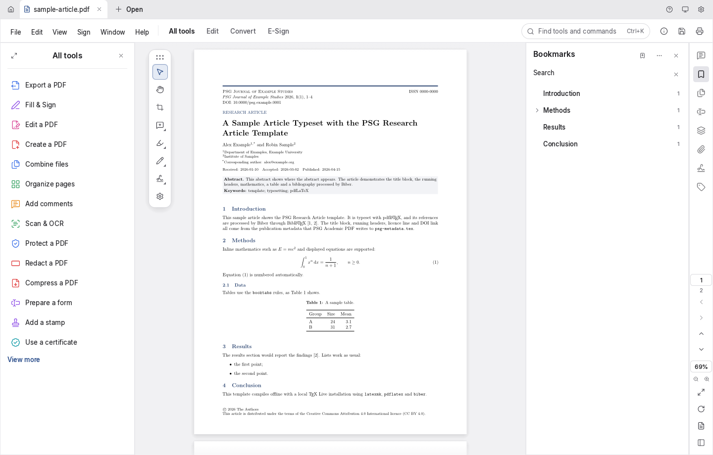
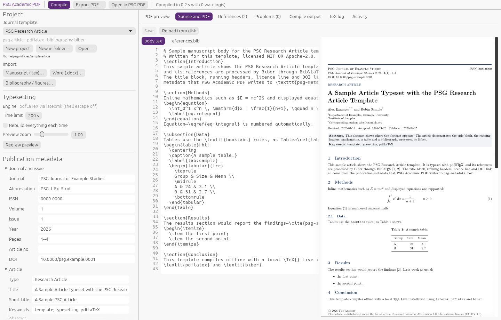

  
  &nbsp;&nbsp;&nbsp;
  

<h1 align="center">PSG PDF &amp; PSG Academic PDF</h1>

  <b>Professional PDF workflows and scholarly typesetting, on your own computer.</b> 
  Two open-source desktop applications from Panorama Scholarly Group.

  
  
  
  

  <a href="https://pdf.panorama-sg.com/"><b>pdf.panorama-sg.com</b></a> ·
  <a href="#psg-pdf">PSG PDF</a> ·
  <a href="#psg-academic-pdf">PSG Academic PDF</a> ·
  <a href="#which-one-do-i-need">Compare</a> ·
  <a href="#downloads">Downloads</a> ·
  <a href="#documentation-and-support">Documentation</a> ·
  <a href="#about-and-license">About</a>

## Two products, one family

Panorama Scholarly Group makes two PDF applications for people who work with documents
seriously. **PSG PDF** is the everyday PDF workbench: read, comment on, fill in, sign, organize
and protect PDFs. **PSG Academic PDF** is for the last step of scholarly publishing: it turns an
accepted manuscript and its publication metadata into a journal-ready PDF.

They are separate products. Each has its own installer, updates, settings and uninstaller, and
either works without the other. Both are native apps built in Rust on one shared PDF engine. Both
work offline: neither needs an account, neither sends your documents anywhere, and neither
checks for updates unless you ask it to.

## PSG PDF

**Reading, organizing and protecting PDFs.** A fast desktop app for the PDF work of every day.

 

  

- **Read** with sharp rendering at any zoom, continuous, single-page and two-up layouts, full
  screen, light and dark themes, search, bookmarks, thumbnails and layers.
- **Comment** with highlights, sticky notes, shapes, drawings and stamps, in threaded comments.
- **Fill and sign** forms, author form fields, and add typed signatures in Latin, Chinese,
  Japanese, Korean, Arabic and Hebrew scripts, or a certificate signature.
- **Organize** pages like cards: reorder, rotate, insert, delete, crop; combine files and split
  documents.
- **Protect** documents with passwords and permissions, redaction and removal of hidden
  information.
- **Edit** text and images on the page, add headers, footers, watermarks and backgrounds.
- **Convert and export** pages to images and documents to Word, RTF, HTML and Markdown, and
  print.
- **Scan and OCR**: recognise the text of scanned pages and review it before it is applied.
- **Automate** with the `pdfcraft-cli` command-line tool, which ships with PSG PDF.

Some areas are still maturing, and we say so: editing existing text works best on Latin-script
documents, the built-in OCR reads Latin script, Word export does not yet keep the original layout, and there
is no import of Office documents to PDF yet. The [engine's status](docs/gaps.md) lists what is
missing.

## PSG Academic PDF

**Typesetting accepted articles with pdfLaTeX.** From manuscript to the journal's final PDF.

 

  

- **Journal templates**: start from the PSG Research Article (numbered citations) or the PSG
  Humanities and Social Sciences Article (author-year citations and footnotes) template.
- **Manuscripts**: import a LaTeX manuscript, or a Word manuscript (experimental, through
  Pandoc), with its bibliography and figures.
- **Publication metadata**: journal, volume, issue, pages, DOI, authors, affiliations, ORCID
  iDs, abstract, keywords, dates, licence and copyright, checked as you type (DOI, ISSN and ORCID
  check digits, dates).
- **References**: BibLaTeX with Biber, with checks for duplicate keys, missing fields, malformed
  DOIs, citations without an entry and entries nothing cites.
- **Typesetting**: pdfLaTeX through latexmk, using the TeX installation on your computer, in a
  sandbox with shell escape off and a time limit you can cancel.
- **Source and PDF side by side**, with problems marked on their lines and plain-language hints
  for common TeX errors.
- **Interface languages**: English, Simplified Chinese, Traditional Chinese, Japanese, Korean
  and German.

PSG Academic PDF needs a TeX installation (TeX Live or MacTeX with latexmk and Biber). It
typesets Latin-script articles with pdfLaTeX; XeLaTeX and LuaLaTeX, and with them Chinese,
Japanese and Korean manuscripts, are not supported yet. It has no submission or peer-review
workflow. See the [PSG Academic PDF guide](docs/academic-guide.md).

## Which one do I need?

| | PSG PDF | PSG Academic PDF |
|---|---|---|
| **For** | Anyone who reads, reviews, fills in, signs or prepares PDFs | Journal editors, production editors and authors preparing accepted articles |
| **Starts from** | An existing PDF | A manuscript (`.tex`, experimental `.docx`) and a journal template |
| **Produces** | The same PDF, commented, filled, signed, reorganized or protected | A new, typeset article PDF with its publication metadata |
| **Main tools** | Viewer, comments, forms, signatures, page organizer, redaction, OCR, export | Templates, metadata form, bibliography checks, source editor, pdfLaTeX preview |
| **Needs** | Nothing else | A local TeX installation (pdfLaTeX, latexmk, Biber) |
| **Opens** | `.pdf` | `.tex` and `.docx` manuscripts, PSG Academic PDF projects |
| **Colour** | Deep blue | Academic purple |

They work well together: PSG Academic PDF's **Open in PSG PDF** hands the finished article to
PSG PDF for review, when both are installed.

## Downloads

Every release on the [releases page](https://github.com/WENSHAO521/psg-pdf/releases) has both
products, each in its own section, with SHA-256 checksums. Stable releases are marked
**Latest**; betas are marked **Pre-release**, and the apps show **Beta** beside their name.

| Platform | PSG PDF | PSG Academic PDF |
|---|---|---|
| **Windows** 10 and 11, x64 | `psg-pdf-<version>-windows-x64.msi`, portable `.zip` | `psg-academic-pdf-<version>-windows-x64.msi`, portable `.zip` |
| **macOS** 11 or later, Apple silicon and Intel | `psg-pdf-<version>-macos-universal.dmg` | `psg-academic-pdf-<version>-macos-universal.dmg` |
| **Linux** x86_64 | `.deb`, `.rpm`, `.AppImage`, `.tar.gz` | `.deb`, `.rpm`, `.AppImage`, `.tar.gz` |

  <a href="https://github.com/WENSHAO521/psg-pdf/releases/latest"><b>Download the latest release</b></a> ·
  <a href="https://github.com/WENSHAO521/psg-pdf/releases">All releases and betas</a>

Upgrading from the old combined **PSG PDF Suite** (0.18)? The new PSG PDF replaces it and keeps
your settings; see [migrating from the suite](docs/products.md#migrating-from-the-suite).

## Documentation and support

- **[Website](https://pdf.panorama-sg.com/)**: the product site, with downloads for every platform.
- **[Panorama Scholarly Group](https://panorama-sg.com/)**: the publisher's website.
- **[Documentation](docs/README.md)**: user guides, the products and their installers,
  building from source, and the engine's technical notes.
- **[PSG Academic PDF guide](docs/academic-guide.md)**: what it needs and how to make an
  article.
- **[Report a problem or suggest an improvement](https://github.com/WENSHAO521/psg-pdf/issues/new/choose)**:
  please say which product and version you use.
- **[Release history](https://github.com/WENSHAO521/psg-pdf/releases)** and the
  **[changelog](CHANGELOG.md)**.

## About and license

PSG PDF and PSG Academic PDF are made by **Panorama Scholarly Group** and contributors. The
[PSG brand guide](docs/brand.md) describes the names, logos and colours.

The code is licensed under the [MIT License](LICENSE-MIT) or the
[Apache License 2.0](LICENSE-APACHE), at your option. Both products are built on the
PdfCraft PDF engine by the ArtCraft team (MIT OR
Apache-2.0); as PdfCraft's terms require of modified versions, they carry none of its brand.
Third-party notices are in [NOTICE](NOTICE), and every bundled asset and its licence is listed in
[ATTRIBUTION.md](ATTRIBUTION.md).
