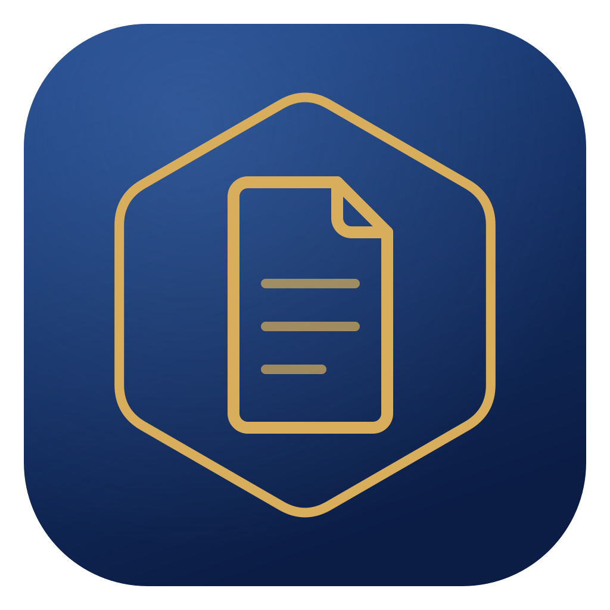
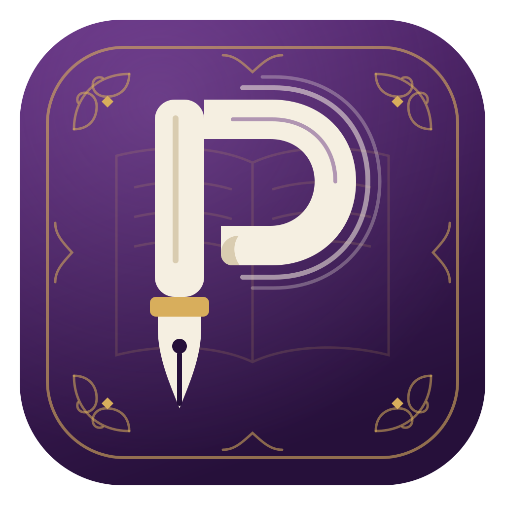

# PSG PDF and PSG Academic PDF app icons




Both icons are rendered from one editable master, [`assets/brand/psg-logo-master.svg`](../brand/README.md).
They share the tile shape, the cream and the gold, and differ in field colour and motif:

- **PSG PDF** (deep blue: simple, professional, general purpose): a page with a folded corner and three
  text lines, drawn in a single gold line inside a rounded hexagon.
- **PSG Academic PDF** (academic purple: precise, elegant, publishing-minded): a P monogram whose stem is a
  fountain pen (gold ring and nib) and whose bowl is a curling page, inside a fine gold keyline with corner
  scrollwork and a faint open-book watermark.

At 48 px and below the generator uses each product's compact variant (`class="compact"` in the master): a
filled page for PSG PDF, and the P without the ornament for PSG Academic PDF, so small icons stay legible.

| Colour | Hex | Used for |
|---|---|---|
| Cream | `#f5efe1` | the P monogram, the compact page |
| Gold | `#d8ae5c` | line work, the pen's ring and nib, ornament |
| Deep blue | `#1e4384` → `#0b1d45` | PSG PDF field |
| Academic purple | `#5b2a78` → `#26103a` | PSG Academic PDF field |

**Provenance:** contributor-original artwork drawn as SVG for this project, inspired only by the general
style the owner chose (gold line art on a dark tile; a book-and-pen monogram); nothing was traced or copied,
and no fonts or third-party graphics are used. Licence: [LICENSE.txt](LICENSE.txt) (`MIT OR Apache-2.0`,
like the repo).

## Files

| File | What it is |
|---|---|
| `psg-pdf.svg` | the product's icon, cut from the brand master |
| `psg-pdf-1024.png`, `psg-pdf-256.png` | rasters; the 256 px one is the runtime window icon |
| `psg-pdf.icns` | macOS icon |
| `psg-pdf.ico` | Windows icon (16–256 px) |
| `hicolor/<n>x<n>/apps/com.panoramascholarly.psgpdf.png` | Linux hicolor theme, 16–512 px |
| `hicolor/scalable/apps/com.panoramascholarly.psgpdf.svg` | Linux scalable icon (copy of `psg-pdf.svg`) |
| `pdfcraft-document.svg`, `pdfcraft-document.ico` | Windows PDF file icon (see below) |

`assets/app-icon-academic/` holds the same set for PSG Academic PDF (`psg-academic-pdf.*`,
`com.panoramascholarly.psgacademicpdf`).

Windows PDF files use resource 2 when the app is chosen as the default reader. That document outline is
adapted from Lucide `file-text` 1.49.0 (ISC); its badge and outlined lettering are original
(`MIT OR Apache-2.0`), covered by [LICENSE-document.txt](LICENSE-document.txt).

## Regenerate

```sh
python3 packaging/psg-icons.py            # needs resvg on PATH and Pillow; edit the master, never the outputs
python3 packaging/macos/dmg/generate.py   # the DMG backgrounds use the icons
cargo xtask assets                        # then update the sha256 values in ATTRIBUTION.toml and run with --write
```
